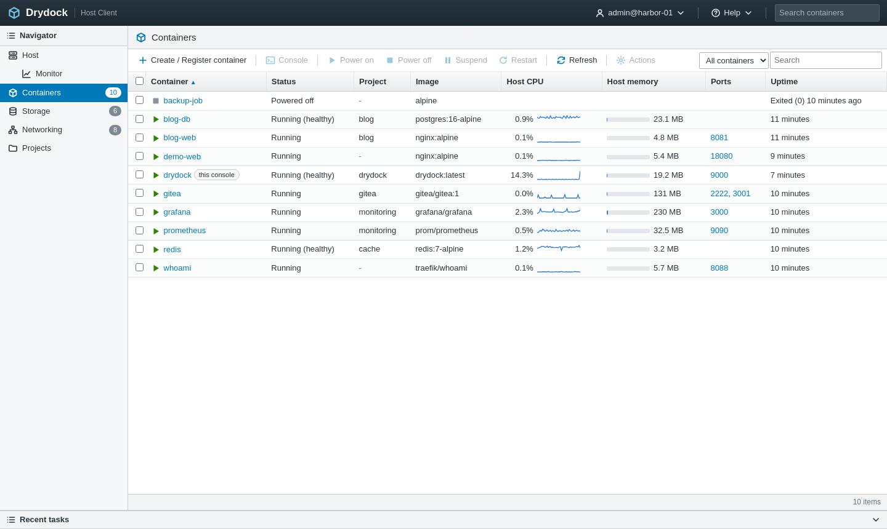
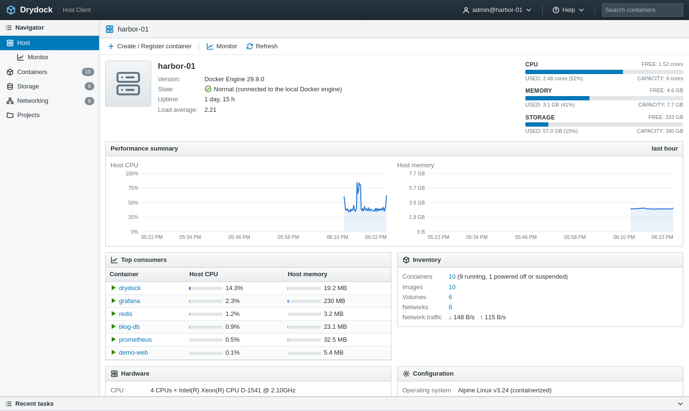
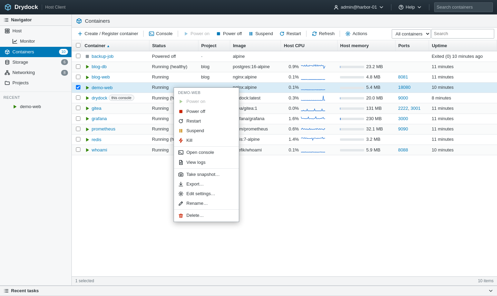
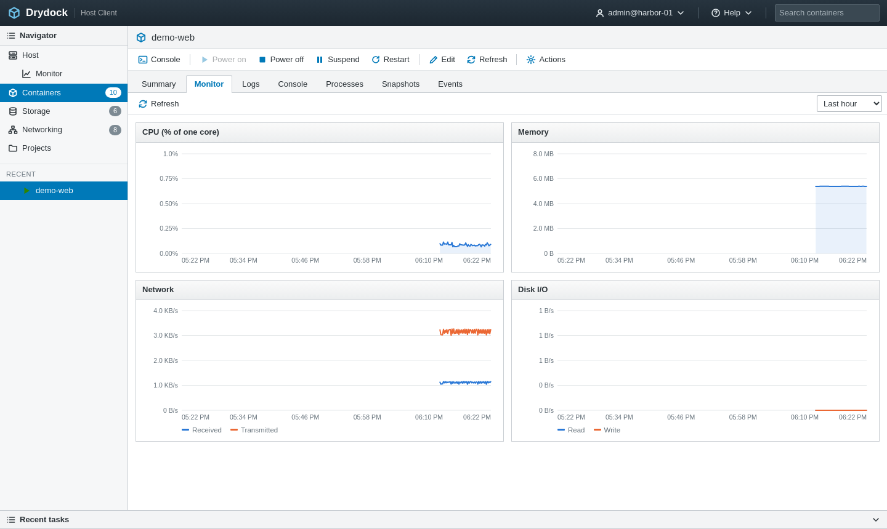
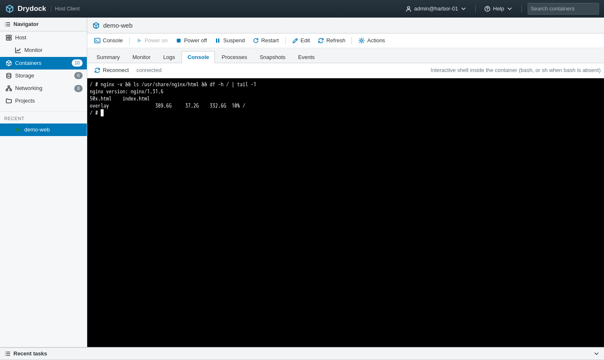
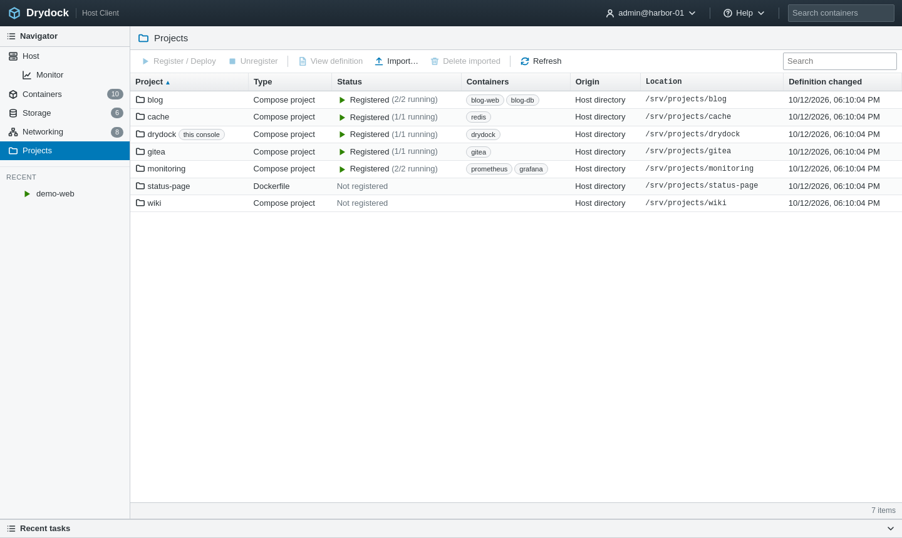
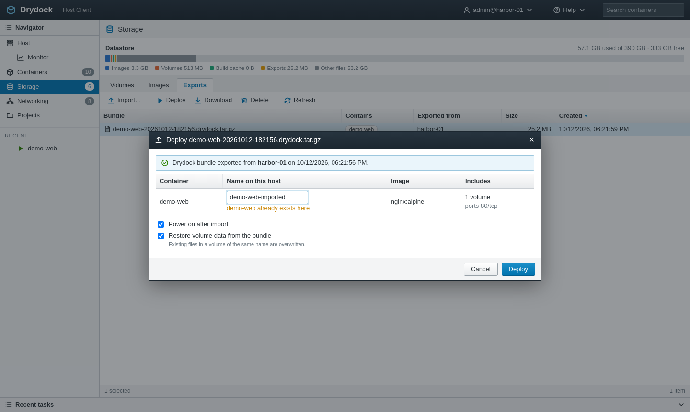

# Drydock

**A web console for the Docker containers on one host, laid out like a hypervisor host client.**

Drydock gives a single Docker host the kind of console you get from a hypervisor: an
inventory you can sort and search, power buttons, performance history, an in-browser
console, snapshots, and a way to move workloads in and out as files. It runs as one small
container next to the containers it manages and needs nothing else installed.



## Contents

- [Why](#why)
- [Quick start](#quick-start)
- [What you can do with it](#what-you-can-do-with-it)
- [Configuration](#configuration)
- [Documentation](#documentation)
- [Security](#security)
- [Limits worth knowing](#limits-worth-knowing)
- [Licence](#licence)

## Why

On a home server or a small lab box, containers tend to accumulate: a few compose projects,
a couple of one-off `docker run` commands, something cloned from Git last month. The Docker
CLI answers any single question well, but it does not show you the whole host at once, it
keeps no history, and moving a container to another machine means collecting the image,
the volumes and the run configuration by hand.

Drydock fills that gap with a familiar layout: a navigator on the left, a toolbar and grid
in the middle, and a Recent tasks panel along the bottom that records every operation, who
started it and how it ended.

## Quick start

You need Docker Engine 25 or newer with the Compose plugin, on Linux.

```bash
git clone https://github.com/grahamfairbank/drydock.git
cd drydock
cp .env.example .env
```

Edit `.env` and set three values: a password, the directory that holds your projects, and
an absolute path for Drydock's data.

```ini
DRYDOCK_PASSWORD=choose-a-strong-password
DRYDOCK_PROJECTS_ROOT=/home/you
DRYDOCK_DATA=/home/you/drydock/data
```

Then build and start it:

```bash
docker compose up -d --build
```

Open `http://<host>:9000` and sign in as `admin` with the password you set. To change the
password later, run `./set-password.sh`: editing `.env` alone does not affect a running
container. The full
walkthrough, including upgrades and running behind a reverse proxy, is in
[docs/installation.md](docs/installation.md).

## What you can do with it

### See the whole host

- **Host summary** with CPU, memory and storage capacity meters, the last hour of load,
  the busiest containers and any active alarms.
- **Inventory** of every container: state, health, compose project, image, live CPU with a
  sparkline, memory, published ports as clickable links, and uptime. Sort any column,
  search, filter to running or powered-off containers, select several at once.
- **Alarms** for restart loops, failed health checks, non-zero exits, containers close to
  their memory limit, and a host that is running out of disk or memory.



### Control containers

- **Power on, power off, restart, suspend, resume and kill**, for one container or a
  selection. Right-click any row for the same Actions menu the toolbar offers.
- **Edit settings live**: autostart policy, CPU limit and memory limit apply without a
  restart.
- **Rename and delete**, with an explicit choice about anonymous volumes.
- **Notes** on each container, kept by Drydock.



### Watch utilization and trends

- Drydock samples every running container and the host **every 10 seconds** and keeps
  **30 days** of history.
- **Charts** for CPU, memory, network and disk I/O per container, and for the host, over the
  last hour, 6 hours, day, week or month.
- A **Trends** page compares each container's last hour with its last day, flags memory
  that keeps growing, and projects when the host's storage will fill at the current rate.



### Work inside a container

- An **interactive console** in the browser: a real terminal attached to a shell in the
  container.
- A **live log tail** with follow, line filter and download.
- The **process list**, refreshed every few seconds.



### Import projects as containers

- The **Projects** view lists every directory under your projects root that contains a
  compose file or a Dockerfile, and shows which are already running. Register one to deploy
  it, rebuild it after a change, or unregister it; build output streams into the task log.
- The **Create / Register** wizard also takes an uploaded archive or a Git URL. Upload a
  file and Drydock works out whether it is a Drydock bundle, a `docker save` image archive,
  or a zipped project.



### Export containers

- **Export** writes a single portable file holding the container's configuration, its image,
  the data in its named volumes and a reference compose file.
- **Import** that file on any Drydock host to re-create the container, under the same name
  or a new one. See [docs/import-export.md](docs/import-export.md) for the format.



### Snapshots

- **Take a snapshot** of a container's filesystem before a risky change, and **revert** to
  it later. Several snapshots can be kept per container.

### Storage and networking

- **Volumes** with their size and which containers use them, **images** with what depends
  on them, and a datastore bar showing where the disk went.
- **Networks** with subnets and attached containers, and a **port map** of every published
  host port.

## Configuration

All settings are environment variables, read from `.env` by the compose file.

| Variable | Default | Purpose |
|---|---|---|
| `DRYDOCK_USER` | `admin` | Sign-in name for the console. |
| `DRYDOCK_PASSWORD` | *(required)* | Sign-in password. Drydock refuses to start without one. |
| `DRYDOCK_PORT` | `9000` | Host port the console is published on. |
| `DRYDOCK_PROJECTS_ROOT` | *(required)* | Directory scanned for projects. Mounted read-only. |
| `DRYDOCK_DATA` | *(required)* | Absolute host path for metrics history, exports and imported projects. |

Settings are read when the container is created, so after editing `.env` run
`docker compose up -d` to apply them. For the password there is a script that does both
steps: `./set-password.sh` (or `./set-password.sh --generate` for a random one).

Both paths are mounted into the container at the same path they have on the host. That is
deliberate: see [docs/architecture.md](docs/architecture.md#same-path-mounts).

## Documentation

| Guide | What it covers |
|---|---|
| [Installation](docs/installation.md) | Requirements, setup, changing the password, upgrading, backups, reverse proxy, uninstalling. |
| [User guide](docs/user-guide.md) | Every view and action in the console. |
| [Import and export](docs/import-export.md) | Projects, bundles, image archives, Git, and the bundle format. |
| [API reference](docs/api.md) | The HTTP API the console itself uses. |
| [Architecture](docs/architecture.md) | How Drydock is built, where state lives, how to work on it. |
| [Security](docs/security.md) | What access Drydock has and how to deploy it safely. |
| [Troubleshooting](docs/troubleshooting.md) | Common problems and how to resolve them. |

## Security

Drydock controls the Docker engine through its socket, which is equivalent to root on the
host. Anyone who can sign in can run anything on that machine. Use a strong password, and
keep the port on a network you trust or put it behind a TLS reverse proxy: the built-in
server speaks plain HTTP. Details are in [docs/security.md](docs/security.md).

## Limits worth knowing

- Drydock manages **one host**: the Docker engine whose socket it is given.
- Snapshots and bundles capture the container filesystem and named volumes. The contents of
  **bind-mounted host directories are not captured**; their paths are recorded.
- Reverting to a snapshot re-creates the container from the snapshot image. A later
  `docker compose up` for that project puts it back on the project's own image.
- A CPU or memory limit can be set or changed live, but removing one means re-creating the
  container.
- There is one user account. Sessions are held in memory, so you sign in again after
  Drydock restarts.

## Licence

Drydock is released under the [MIT Licence](LICENSE). It bundles
[xterm.js](https://xtermjs.org/) for the console, also under the MIT licence; see
[NOTICE](NOTICE).

Drydock is an independent project. Its layout is inspired by hypervisor host clients, but
it is not affiliated with, endorsed by or derived from any hypervisor vendor's product, and
it is not affiliated with Docker, Inc.
