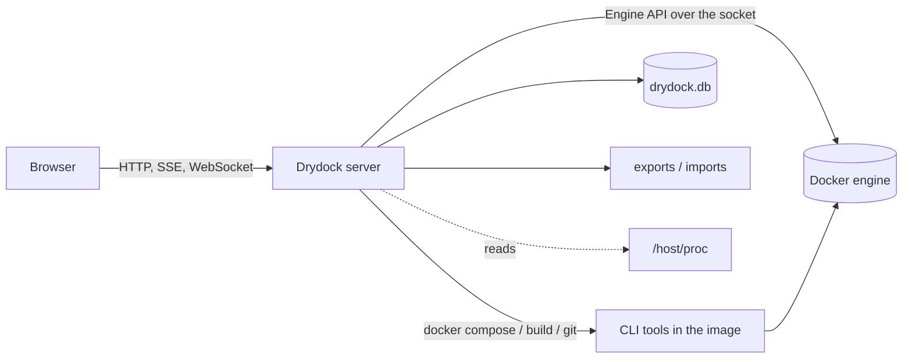

# Architecture

Drydock is deliberately small: one Python process with no third-party packages, one static
web page, one SQLite file.



## Components

### Server (`drydock/`)

| Module | Role |
|---|---|
| `dockerapi.py` | A minimal Docker Engine API client over the unix socket: JSON calls, streamed responses, log demultiplexing, and connection hijacking for interactive exec. |
| `store.py` | SQLite storage, the metrics collector, the event listener, and the queries behind charts and trends. |
| `tasks.py` | The task engine. Each change runs in its own thread, captures its output and is recorded. |
| `ops.py` | The operations themselves: lifecycle, create, snapshots, export, import, projects. |
| `server.py` | HTTP routing, sessions, static files, the log stream and the console WebSocket. |

The server is Python's `ThreadingHTTPServer`: one thread per connection, which suits a
console used by a handful of people. The WebSocket framing for the console is implemented
directly on the socket, which is what keeps the server free of dependencies.

Most work goes straight to the Engine API. Three things use command-line tools instead,
because re-implementing them would be a poor trade: `docker compose` for compose projects,
`docker build` for Dockerfile projects, and `git clone`. These come from the official
Docker CLI image the container is built on.

### Web client (`web/`)

| File | Role |
|---|---|
| `index.html` | The page shell and the icon set. |
| `app.js` | Core: API calls, polling, routing, the grid, charts, dialogs and menus. |
| `views.js` | Every view, the container actions and the creation wizard. |
| `app.css` | All styling. |
| `vendor/` | xterm.js and its fit add-on, used only by the console tab. |

There is no build step and no framework. The client polls `/api/overview` every three
seconds and re-renders the current view; rendering skips the DOM write when the generated
markup is unchanged, which keeps selection, hover and scroll position steady. Charts are
drawn as inline SVG.

## Metrics pipeline

A collector thread wakes every 10 seconds and:

1. lists running containers and requests a one-shot stats sample for each, eight at a time;
2. derives rates from the change in the cumulative counters since the previous sample:
   CPU from nanoseconds of CPU time, network and block I/O from byte counts;
3. reads host CPU, memory and load from `/host/proc`, network counters from the host's
   network namespace (`/host/proc/1/net/dev`, ignoring loopback and virtual interfaces),
   and disk usage from the filesystem holding the projects root;
4. writes one row per container and one for the host.

Memory is reported as usage minus inactive file cache, matching `docker stats`.

To keep 30 days without the database growing large, samples are stored at three
resolutions. The collector averages the raw samples into one-minute and ten-minute rows as
it goes, and prunes each resolution at its own age.

| Resolution | Kept for | Used by |
|---|---|---|
| 10 seconds | 2 hours | Last hour |
| 1 minute | 2 days | Last 6 hours, last day, container trends |
| 10 minutes | 30 days | Last week, last month, storage forecast |

Chart queries bucket rows so a response holds at most about 360 points. Series are keyed
by container **name**, so history survives a container being re-created.

Trends are computed on request with an ordinary least-squares fit: memory against time per
container over the last day, and storage used against time for the host over the last
week.

## Re-creating containers

Snapshots, bundle imports and reverts all need to build a container that matches an
existing one. Drydock does this from the container's full `inspect` document: the `Config`
and `HostConfig` sections are sent back to the create endpoint as they are, with the image
replaced where needed and network endpoints rebuilt from the recorded attachments. Nothing
is translated through an intermediate format, so settings Drydock has never heard of are
carried over too.

A revert renames the old container aside, creates and starts the new one, and removes the
old one only after that succeeds. If anything fails, the new container is removed and the
old one is renamed back and restarted.

## Same-path mounts

The projects root and the data directory are mounted into the Drydock container **at the
same absolute path they have on the host**.

The reason is how bind mounts work. When a compose file says `./content:/srv`, the compose
tool resolves `./content` to an absolute path and hands it to the Docker engine, and the
engine looks that path up **on the host**. If Drydock saw the project at `/projects/site`
while the host has it at `/home/you/site`, compose would ask for `/projects/site/content`,
a path that does not exist on the host, and the container would get an empty directory.

With identical paths on both sides, a project deploys the same way from Drydock as from a
shell on the host, and the containers are interchangeable. The same applies to projects
Drydock imports, which is why the data directory must be an absolute host path as well.

## Where state lives

| Location | Contents |
|---|---|
| `DRYDOCK_DATA/drydock.db` | Metrics, tasks, events, notes. SQLite in WAL mode. |
| `DRYDOCK_DATA/exports/` | Exported bundles. |
| `DRYDOCK_DATA/imports/` | Projects imported from archives and Git. |
| `DRYDOCK_DATA/uploads/`, `tmp/` | Transient working files. |
| Docker images `drydock-snapshots/*` | Snapshots, labelled with the container they belong to. |
| Container label `drydock.project.dir` | Links a container to the Dockerfile project it was built from. |
| Memory | Sessions and the live state of running tasks. |

Drydock keeps no inventory of its own. The list of containers, images, volumes and
networks always comes from Docker, so changes made with the CLI show up immediately and
nothing can drift out of sync.

## Developing

The quickest loop is to edit and rebuild the container:

```bash
docker compose up -d --build
docker logs -f drydock
```

The server can also run directly on the host for faster iteration. It needs Python 3.12 or
newer, access to the Docker socket, and the `docker` CLI on the path:

```bash
DRYDOCK_PASSWORD=dev DRYDOCK_DATA=$PWD/data DRYDOCK_PROJECTS_ROOT=$HOME \
  python3 -m drydock.server
```

Conventions worth keeping:

- **No dependencies.** The server uses only the standard library, and the client has no
  build step. A change that needs a package should make a strong case for it.
- **Every change is a task.** Route new mutating operations through `Handler.task` so they
  are logged, attributed and visible in the console.
- **Docker is the source of truth.** Read state from the engine rather than caching it.
- **Escape everything.** The client builds markup from strings; every value that
  originates outside the code goes through `esc()`.
- **Guard the host.** Paths that come from a request are resolved and checked against the
  projects root or the data directory before use.
