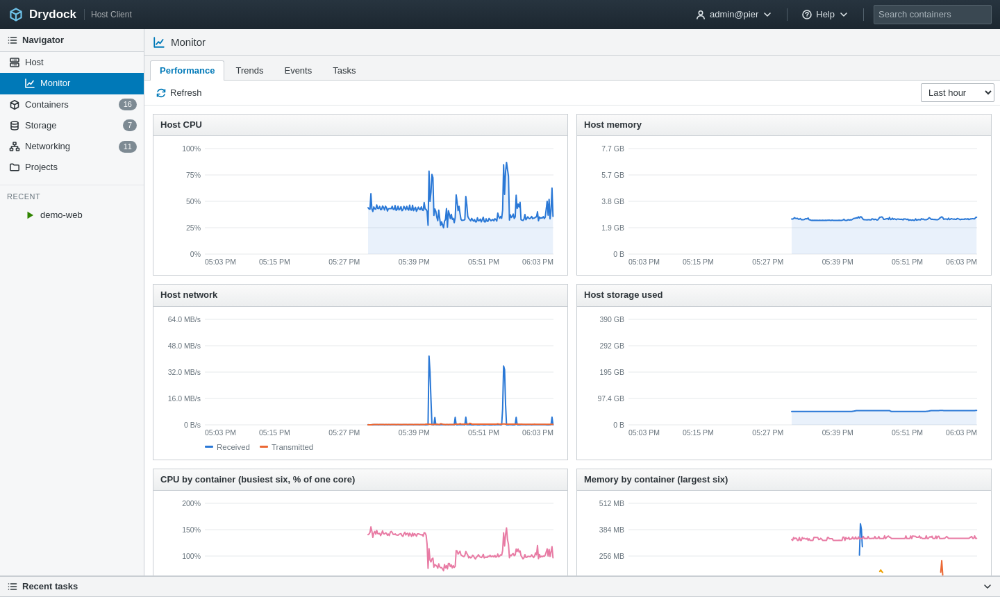
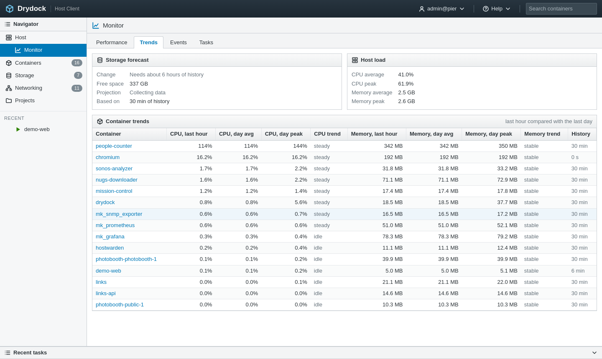
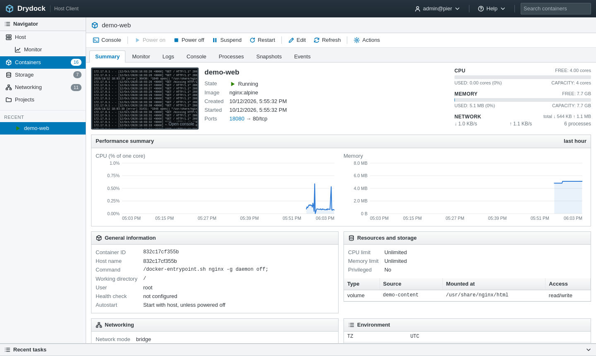
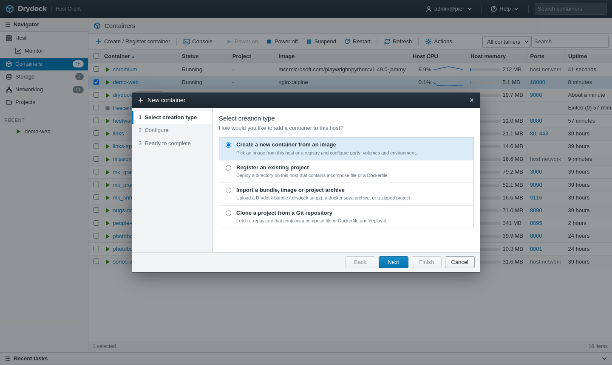
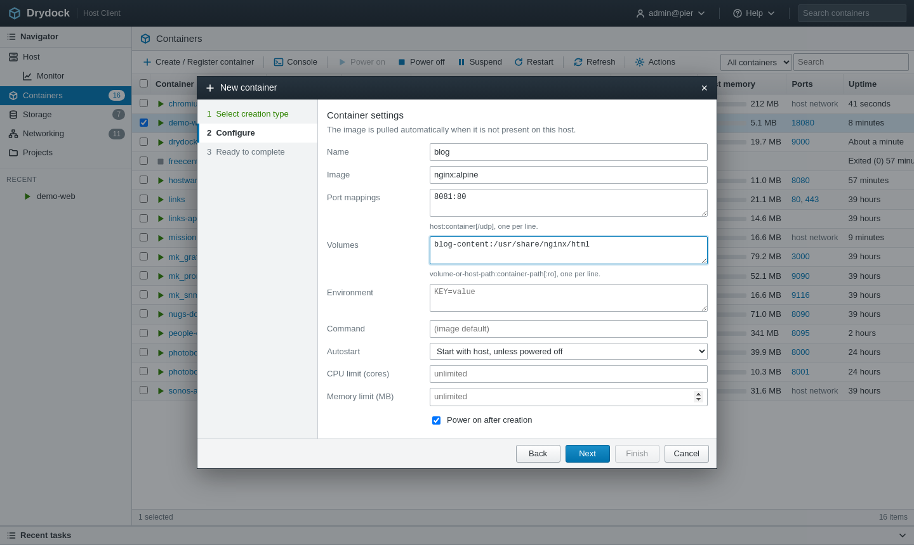

# User guide

This guide walks through the console view by view.

- [The layout](#the-layout)
- [Host](#host)
- [Monitor](#monitor)
- [Containers](#containers)
- [A single container](#a-single-container)
- [Creating and registering containers](#creating-and-registering-containers)
- [Storage](#storage)
- [Networking](#networking)
- [Projects](#projects)
- [Tasks](#tasks)
- [Alarms](#alarms)

## The layout

The screen has four fixed parts.

- The **header** shows who is signed in and on which host, a Help menu, and a search box
  that jumps to the container list and filters it as you type. When alarms are active a
  yellow counter appears here.
- The **Navigator** on the left switches between Host, Monitor, Containers, Storage,
  Networking and Projects. Badges show counts. Containers you opened recently are listed
  below for quick access.
- The **content area** has a title bar, a toolbar and usually a grid.
- **Recent tasks** along the bottom lists the latest operations. Click its header to
  collapse it; click a row to see the task's output.

Grids behave the same everywhere:

- Click a column header to sort; click again to reverse.
- Click a row to select it. **Ctrl-click** (Cmd-click on macOS) or use the checkboxes to
  select several.
- **Right-click** a row for its Actions menu.
- **Double-click** a row to open it.

The console refreshes itself every three seconds, so there is rarely a need to press
Refresh.

## Host

The Host page is the overview of the machine.

- The top block shows the host name, Docker Engine version, uptime and load average. State
  reads *Normal* unless there are alarms.
- Three **capacity meters** show CPU (in cores), memory and storage. The bar turns amber
  above 75% and red above 90%.
- **Alarm banners** appear above the summary, each linking to the container concerned.
- **Performance summary** charts host CPU and memory over the last hour.
- **Top consumers** lists the six busiest containers right now.
- **Inventory**, **Hardware** and **Configuration** give counts and the facts about the
  machine and its Docker installation.

## Monitor

Monitor holds the host-wide history, in four tabs.

### Performance

Six charts: host CPU, host memory, host network (received and transmitted), storage used,
and CPU and memory broken down by container for the six heaviest. Choose the period at the
top right: last hour, 6 hours, day, week or month. Hover over a chart to read exact values.

Container CPU is shown as a percentage of one core, as `docker stats` does, so a container
using two full cores reads 200%. Host CPU is a percentage of all cores.

How much detail each period has:

| Period | Resolution | Kept for |
|---|---|---|
| Last hour | 10 seconds | 2 hours |
| Last 6 hours, last day | 1 minute | 2 days |
| Last week, last month | 10 minutes | 30 days |

History follows the container **name**, so it continues across a re-create or a redeploy.

### Trends

- **Storage forecast** fits a line through storage use over the past week and, when growth
  is sustained, says in how many days the disk fills at that rate. It needs about six hours
  of history before it reports anything.
- **Host load** gives the average and peak CPU and memory over the same window.
- **Container trends** compares each running container's last hour with its last day:
  current, average and peak for CPU and memory, a CPU trend (steady, up or down by a
  percentage), and a **memory trend** that flags a container whose memory has been rising
  steadily. A container is flagged when it has at least three hours of history, the rise is
  consistent, and at that rate it would grow by more than 15% of its daily average within a
  day. That pattern is the usual sign of a leak.

### Events

The Docker event stream for the host: containers starting, stopping and dying (with exit
codes), images pulled and deleted, networks and volumes created and removed. Health-check
probes and other high-frequency noise are filtered out. The latest 5,000 events are kept.

### Tasks

The full task history, where Recent tasks shows only the latest few.

## Containers

The inventory lists every container on the host, running or not.

| Column | Meaning |
|---|---|
| Container | Name and a state icon: green triangle running, grey square powered off, amber bars suspended, red for restart loops or failed health checks. |
| Status | Running, Powered off, Suspended and so on, with health and exit code where known. |
| Project | The compose project the container belongs to, if any. |
| Image | The image it was created from. |
| Host CPU | Current CPU and a sparkline of the last few minutes. |
| Host memory | Current memory, with a bar relative to the host total. |
| Ports | Published host ports. TCP ports are links that open the service. |
| Uptime | How long it has been running, or when it exited. |

The **quick filter** on the right narrows the list to running, powered-off, or alarmed
containers; the **search** box matches name, image, project and status.

### Power operations

Select one or more containers and use the toolbar, or right-click for the menu.

| Action | What it does |
|---|---|
| Power on | Starts a stopped container, or resumes a suspended one. |
| Power off | Asks the container to shut down, and kills it after 10 seconds. Asks for confirmation. |
| Restart | Stops and starts the container. |
| Suspend / Resume | Freezes and thaws all processes in the container. Memory stays allocated. |
| Kill | Stops the container immediately, without a graceful shutdown. |

### Other actions

- **Open console** and **View logs** jump to those tabs.
- **Take snapshot** captures the container's filesystem. See [Snapshots](#snapshots).
- **Export** writes a portable bundle. See [Import and export](import-export.md).
- **Edit settings** changes the autostart policy, CPU limit and memory limit. Changes apply
  at once, without a restart. A limit can be set or changed, not removed.
- **Rename** changes the container's name. Its metrics history stays under the old name.
- **Delete** removes the container. Named volumes and bind-mounted directories are always
  kept; tick the box to remove anonymous volumes as well.

The container Drydock itself runs in is marked *this console*. Power off, suspend, kill,
rename and delete are disabled for it.

## A single container

Click a container's name to open it. The toolbar repeats the power buttons; seven tabs
sit below.

### Summary

- A **thumbnail** of the latest log output stands in for a screen. Click it to open the
  console (or the logs, if the container is powered off).
- State, image, creation and start times, published ports and compose project.
- **Meters** for CPU and memory against the container's limits (or the host's capacity
  when it has none), plus current network rates and process count.
- **Performance summary** for the last hour.
- **General information**: ID, host name, command, working directory, user, health check
  and autostart policy.
- **Resources and storage**: limits, and every volume and bind mount with its access mode.
- **Networking**: each attached network with IP address, gateway and MAC address.
- **Environment**: the container's variables. Values whose names look like secrets
  (`PASSWORD`, `TOKEN`, `KEY` and similar) are masked until you click them.
- **Notes**: free text kept by Drydock. Click Save to store it.
- **Labels**.

### Monitor

CPU, memory, network and disk I/O for this container, over the period you choose.

### Logs

A live tail of the container's output, starting from the last 500 lines.

- **Follow** keeps the view pinned to the newest line.
- **Filter lines** shows only lines containing the text you type.
- **Wrap lines** toggles wrapping.
- **Download** saves what is currently loaded as a text file.

If the container stops, the stream ends; it reconnects when the container starts again.

### Console

An interactive terminal inside the container. Drydock starts `bash` when the image has it
and `sh` otherwise. The terminal resizes with the window, and copy and paste work as in any
terminal.

The session ends when you leave the tab; processes you started in the foreground end with
it. Minimal images with no shell at all (distroless, `scratch`) cannot offer a console.

### Processes

The processes running in the container, refreshed every five seconds.

### Snapshots

A snapshot is a point-in-time copy of the container's filesystem.

- **Take snapshot** asks for a name and a description. The container is paused for a moment
  while the copy is made.
- **Revert to snapshot** re-creates the container from the selected snapshot, keeping its
  current configuration: ports, volumes, environment, networks, limits.
- **Delete** removes a snapshot.

What a snapshot covers:

- **Included:** everything written inside the container's own filesystem.
- **Not included:** data in volumes and bind mounts. Those are untouched by a revert.

After a revert the container runs from the snapshot image rather than its original one. If
the container belongs to a compose project, the next `docker compose up` for that project
re-creates it from the project's own image.

### Events

The Docker events recorded for this container.

## Creating and registering containers

**Create / Register container** opens a wizard with three steps: choose how, configure,
review.

### From an image

| Field | Format |
|---|---|
| Name | Letters, digits, `_`, `.` and `-`. |
| Image | Any reference Docker accepts. Images already on the host are suggested. A missing image is pulled. |
| Port mappings | `host:container`, one per line. Append `/udp` for UDP. Prefix an address to bind to it: `127.0.0.1:8080:80`. |
| Volumes | `name-or-host-path:container-path`, one per line. Append `:ro` for read-only. |
| Environment | `KEY=value`, one per line. |
| Command | Optional. Run through `/bin/sh -c`, replacing the image's default command. |
| Autostart | The restart policy. |
| CPU limit, Memory limit | Optional. |

### From a project, an archive, or Git

These are covered in [Import and export](import-export.md).

## Storage

A **datastore bar** at the top shows how the disk is used: images, volumes, build cache,
exported bundles and everything else.

- **Volumes** lists each volume with its size, driver, compose project and the containers
  using it. Only unused volumes can be deleted. Deleting a volume destroys its data.
- **Images** lists every image with size, age and the containers created from it. *Pull
  image* fetches one from a registry; *Remove dangling images* deletes untagged leftovers.
  Docker refuses to delete an image a container still uses.
- **Exports** lists the bundles you have exported. *Deploy* imports one on this host,
  *Download* saves it to your computer, and *Import* uploads a file from your computer.

Volume sizes are computed by Docker and refreshed about once a minute.

## Networking

- **Networks** shows each Docker network with its driver, subnet, gateway and attached
  containers. An unused network that is not built in can be deleted.
- **Port mappings** lists every published host port, the container behind it and the
  container port it maps to. Useful for finding a free port or seeing what answers on one.

Containers that use the host network stack publish no ports and do not appear in the map.

## Projects

A project is a directory that contains a compose file or a Dockerfile. Drydock lists the
ones it finds under the projects root and the ones you have imported, and shows whether
each is registered, meaning its containers exist on this host.

- **Register / Deploy** builds and starts the project. For a registered project the button
  reads *Rebuild / Redeploy*.
- **Unregister** stops and removes the project's containers. The directory, images and
  volumes are kept, so it can be registered again.
- **View definition** shows the compose file or Dockerfile.
- **Import** uploads a project archive or bundle.
- **Delete imported** removes an imported project's directory once it is unregistered.

Details are in [Import and export](import-export.md).

## Tasks

Every change Drydock makes is a task. A task has a name, a target, the user who started
it, timestamps and a result. Long-running tasks show their current step in the Result
column.

Click any task to open its details and full output. For builds and imports this is where
you find the compose and build log, and it updates live while the task runs. A failed task
also raises a notification in the top-right corner with the reason.

The latest 500 tasks are kept.

## Alarms

Drydock raises an alarm when:

| Condition | Level |
|---|---|
| A container is stuck in a restart loop | Error |
| A container is failing its health check | Error |
| A container exited with a non-zero status (other than a normal stop or kill) | Warning |
| A container with a memory limit is above 90% of it | Warning |
| Host storage is more than 85% full | Warning |
| Host memory is more than 92% used | Warning |

Alarms appear as a counter in the header, as banners on the Host page and on the affected
container's Summary, and through the *With alarms* quick filter. They clear on their own
when the condition ends.
